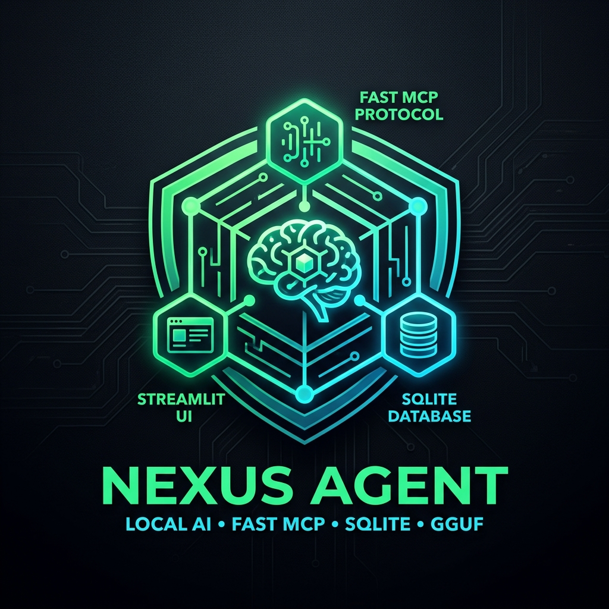
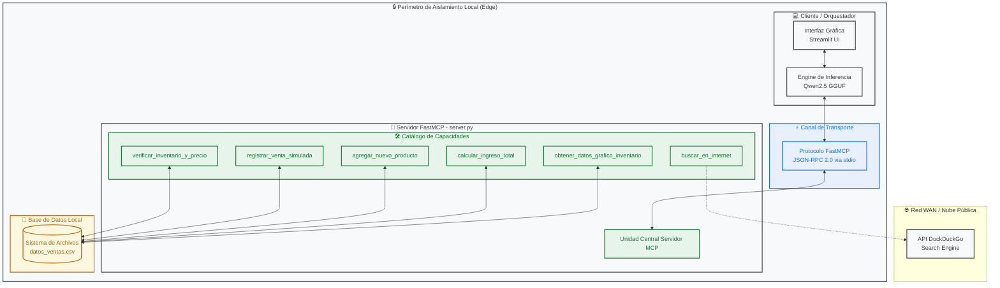

# 🤖 Enterprise BI Agent 

**Ecosistema de Inteligencia Artificial Local (Qwen2.5 7B) conectado en el borde a sistemas de datos corporativos y navegación híbrida asíncrona.**

  <em>"Más allá de las respuestas rígidas: Un cerebro agéntico local diseñado con la capacidad autónoma de seleccionar sus propias herramientas, auditar el inventario y navegar la web en el momento exacto en que el negocio lo requiere."</em>

**Desarrollado por: Msc. Yanet Cesaire Velazquez**

## 🚀 Demo Interactiva en Vivo

Para facilitar la auditoría visual y técnica de la arquitectura de la interfaz del agente, el entorno dinámico ha sido empaquetado y desplegado de forma estática en el borde (Edge):

👉 **[Descargar Informe Técnico Completo (PDF)](./documentos/Informe_Tecnico_Final.pdf)**

👉 **[Probar el Demo del Agente en Vivo](https://86yanetc.github.io/gobernanza_guardrails/demo-mcp/)**

## 🧠 Visión Arquitectónica

El **Enterprise BI Agent** no es una simple interfaz de chat, es una infraestructura cognitiva de grado industrial diseñada para el procesamiento y mutación de datos en el borde (Edge Isolation). Ha sido concebida bajo la premisa de descentralización tecnológica, permitiendo que un modelo de lenguaje de código abierto interactúe de forma segura y directa con sistemas de archivos empresariales y la red pública mediante protocolos desacoplados. Este ecosistema resuelve de raíz los cuatro grandes desafíos de la Inteligencia Artificial en entornos corporativos: **Privacidad Absoluta (Zero-Trust), Latencia de Inferencia, Control de Costos (FinOps) y Confiabilidad Transaccional.**

---

## 💡 Decisiones de Ingeniería y Preguntas Claves

En la construcción de este ecosistema agéntico, se aplicaron principios estrictos de arquitectura de software para transformar modelos generativos locales en una pasarela operativa de grado empresarial. Estas son las respuestas de ingeniería a los pilares de la plataforma:

### 1. ¿Por qué una Arquitectura Desacoplada basada en MCP en lugar de una Integración Monolítica?
Ejecutar inferencias lógicas pesadas junto con manipulación física de bases de datos locales y navegación web asíncrona requiere un aislamiento estricto de responsabilidades:
* **Desacoplamiento Tecnológico:** El uso de **Model Context Protocol (MCP)** mediante transporte `stdio` / JSON-RPC 2.0 permite separar por completo el motor de inferencia (el cliente) de las fuentes de datos (el servidor `FastMCP`). Si la empresa decide migrar su almacenamiento de un archivo CSV local a un clúster de PostgreSQL o SQLite, el código del cliente y el prompt de la IA permanecen intactos; solo se escala el servidor MCP por debajo.

* **Seguridad de Memoria y Procesos:** Al correr las herramientas en un subproceso de terminal aislado (`sys.executable -u`), se mitigan los riesgos de inyección de código o corrupción de memoria en la interfaz gráfica del usuario (Streamlit), garantizando un entorno operativo tolerante a fallos.

### 2. ¿Cómo se optimizó el Retorno de Inversión (FinOps) y la Latencia de Respuesta?
El consumo de APIs comerciales en la nube y los tiempos de espera de red representan los mayores obstáculos económicos y operativos para la IA empresarial. La solución implementada fue una **Infraestructura de Costo Marginal Cero (0\$ Infra)**:
* **Local Edge Inference:** La integración nativa del motor de inferencia `llama-cpp-python` permite ejecutar modelos en formato GGUF (**Qwen2.5-7B / Llama-3.1-8B**) aprovechando el hardware local (aceleración por CPU/GPU). Esto reduce a cero el costo operativo por token, eliminando la dependencia de suscripciones o pagos por uso de proveedores externos.

* **Carga Persistente con Caché de Recursos:** Utilizando el decorador `@st.cache_resource`, los gigabytes del weights del modelo se inicializan en la memoria RAM una única vez al arrancar la infraestructura. Esto reduce la latencia de inicialización a cero milisegundos en consultas subsecuentes, manteniendo un flujo de tokens por segundo altamente competitivo (`Metal/CUDA FP16`).

### 3. ¿Cómo se garantiza la Privacidad, Seguridad y Gobernanza de los Datos Confidenciales?
La filtración de secretos comerciales o datos de clientes a través de APIs en la nube es un riesgo inaceptable para el gobierno corporativo. El framework implementa:
* **Zero-Trust Edge Isolation:** Al ejecutarse el 100% de la cañería de datos en local, la información sensible de ventas, stock y facturación empresarial jamás abandona el perímetro físico de la organización.

* **Type-Safe Validation (Pydantic Guardrails):** Las llamadas autónomas generadas por la IA no impactan directamente en las bases de datos. Pasan por una capa intermedia de validación de esquemas estrictos donde el servidor MCP inspecciona los tipos de datos en el JSON. Si el modelo alucina un parámetro inválido o una columna inexistente, el sistema rechaza la transacción de forma segura y reeduca al modelo mediante mensajes de error del sistema.

* **Manejo de Transacciones Seguro:** Las operaciones de escritura (`registrar_venta_simulada` o `agregar_nuevo_producto`) incorporan mecanismos de validación previa en Pandas (filtros inteligentes por raíces de tokens). Esto previene la duplicación accidental de catálogos y asegura que no se registren transacciones inválidas (como ventas con stock negativo o precios nulos).

### 4. ¿Cuál fue el desafío técnico más complejo?

El verdadero reto fue **hacer convivir el cerebro asíncrono de la IA con la interfaz visual de Streamlit sin que la pantalla se congele o entre en un bucle infinito de recargas.** 

Los modelos locales a veces cometen errores al formatear etiquetas o tardan unos segundos en procesar los datos. Lograr que el cliente de Python intercepte en caliente el bloque `<tool_call>` generado por Qwen, desvíe de forma segura el flujo hacia el servidor MCP y guarde los datos del gráfico en la memoria de la sesión (`st.session_state`) de manera totalmente invisible para el usuario, representó el mayor hito de ingeniería de este desarrollo. Se diseñó un bucle tolerante a fallos que congela los resultados analíticos en pantalla y redibuja los gráficos nativos únicamente cuando la transacción de datos local concluye con éxito.

## 📐 Arquitectura del Sistema & Flujo Transaccional

La solución rompe con los diseños tradicionales rígidos de "chatbots" e implementa una arquitectura híbrida modular basada en componentes desacoplados que se comunican de forma asíncrona local a través del estándar abierto **Model Context Protocol (MCP)**:

## 🧱 Desglose Componente por Componente de la Arquitectura

Para garantizar un diseño modular, de alta velocidad y tolerante a fallos, la infraestructura se divide en cuatro capas operativas estrictamente desacopladas:

### 1. Capa de Presentación (Streamlit UI)
Constituye el frontend perimetral del sistema. Su única responsabilidad es capturar la intención del usuario en lenguaje natural y renderizar las respuestas analíticas.
* **Persistencia de Estado Dinámica (`st.session_state`):** Debido a la naturaleza reactiva de Streamlit (que re-ejecuta el script completo ante cualquier interacción), se implementó un cofre de persistencia en memoria. Esto permite aislar los ciclos de vida de los datos, logrando que los gráficos de barra interactivos permanezcan estáticos e inmutables una vez que la transacción del backend concluye, evitando ejecuciones redundantes del LLM.

### 2. Motor de Inferencia Edge (`Engine GGUF`)
Es el núcleo cognitivo descentralizado de la plataforma. Corre de forma 100% nativa en la CPU/GPU del cliente mediante la librería de bajo nivel `llama-cpp-python`, consumiendo un modelo cuantizado **Qwen2.5-7B-Instruct**.
* **Orquestación ReAct (Reasoning and Acting):** El modelo no opera de forma pasiva. Aplica un bucle de pensamiento iterativo en el cual autoevalúa si la pregunta requiere datos del negocio. Al estar desacoplado de las herramientas, el modelo solo se encarga de generar los tokens XML necesarios (`<tool_call>`) para delegar la fuerza bruta del código hacia la pasarela operativa.

### 3. Canal de Transporte (Handshake JSON-RPC 2.0 via `stdio`)
Es el cordón umbilical que une el cerebro del agente con las capacidades del servidor. 
* **Abstracción Estándar de Mensajería:** En lugar de acoplar funciones de Python directamente a la IA, la comunicación está gobernada por el estándar internacional **Model Context Protocol (MCP)**. Las peticiones de herramientas viajan empaquetadas de manera asíncrona mediante payloads estructurados JSON-RPC a través de tuberías estándar de entrada/salida (`stdio`), logrando que el cliente y el servidor hablen un idioma universal, agnóstico a la tecnología del backend.

### 4. Pasarela Operativa & Catálogo de Capacidades (FastMCP Server)
Constituye el cerebro instrumental del ecosistema. Construido sobre el SDK de `FastMCP`, inicializa un subproceso aislado de terminal que expone y valida de forma estricta (Type-Safe con Pydantic) las habilidades del agente. Se encarga de aislar la persistencia y conectividad mediante dos canales segregados:

#### 🔹 Canal de Datos Privado (Local File System Integration)
- **`verificar_inventario_y_precio`:** Servicio de lectura analítica que expone stock y precios locales, utilizando filtros difusos por tokens semánticos para neutralizar errores sintácticos humanos (como plurales).

- **`registrar_venta_simulada`:** Motor transaccional de escritura encargado de evaluar disponibilidades en disco de forma segura, descontar unidades físicas del inventario y recalcular la facturación en caliente sobre el archivo `datos_ventas.csv`.

- **`agregar_nuevo_producto`:** Servicio de inserción persistente (`INSERT`) que expande de forma autónoma el catálogo de la organización, incorporando guardrails estrictos de comparación de cadenas para mitigar la duplicación accidental de productos.

- **`calcular_ingreso_total`:** Herramienta de agregación matemática encargada de consolidar los flujos financieros históricos acumulados en el negocio.

- **`obtener_datos_grafico_inventario`:** Serializador de datos estructurados encargado de empaquetar las existencias vigentes en arreglos JSON limpios, optimizando el ancho de banda del canal MCP al enviar únicamente las columnas estrictamente requeridas por el frontend.

#### 🌐 Canal de Datos Público (External Cloud Gateway)
- **`buscar_en_internet`:** Orquestador de red externa que actúa como una compuerta segura de capa 7 hacia la API pública de DuckDuckGo. Se ejecuta de forma asíncrona únicamente cuando el modelo de IA deduce que la consulta local no es suficiente para resolver el problema, recuperando snippets comerciales del mercado internacional para inyectarlos limpiamente en la ventana de contexto del agente.
